# APIHub PR board

A board of the open pull requests of one or more GitHub repositories, published on GitHub Pages. It shows CI,
review, and merge-conflict state for each PR and flags PRs that need attention. The link names the repositories,
such as `?repos=owner/name`, and each viewer loads the data with their own GitHub token.

The requirements are in [docs/requirements/](docs/requirements/README.md).

## A tour of the board

Nine steps, from the first look to a board set up your way. The pictures are the screenshot test baselines, taken on
fictional data, so they always match the interface.

### 1. Every open PR on one screen

Each row is a pull request with its CI, review, and conflict state as short codes, its linked issue, its age, and its
last comment. A stripe on the left repeats CI at a glance: red for failing, yellow for running, green for passing. The
board sorts the PRs that need attention to the top.

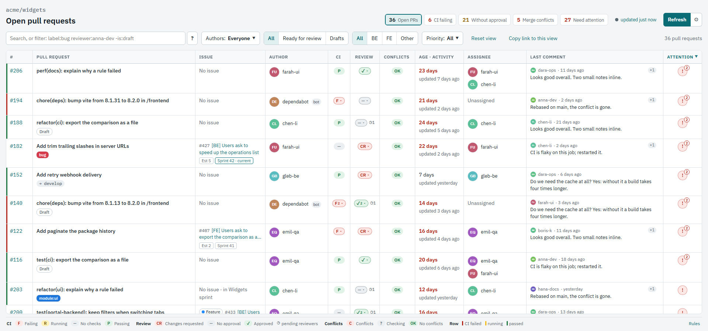

### 2. Start with what needs attention

The tiles at the top count the PRs with failing CI, without approval, with merge conflicts, or that break a team rule;
click one to see only those. The ! icon on a row lists why that PR needs attention: an unconventional title, no
linked issue, or an age past the limit.

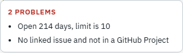

### 3. See why CI fails

Click **F** in the CI column for the checks that failed, each linked to its log, with the workflow and the kind of
failure. A summary job that fails because others did goes last, so the real cause comes first.

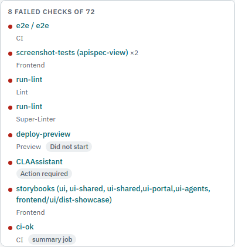

### 4. Know who still has to review

The Review code says approved, changes requested, or no approval, and ◷ counts the reviewers who have not answered.
Click it for who approved, who asked for changes, and who is still waiting. Prefer names to codes? The Review column
can list every reviewer with GitHub's icons, in the order you choose, with your own pending review highlighted.

| The reviewers of a PR | The Review column as a list |
| --- | --- |
| 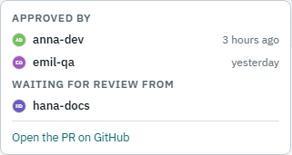 | 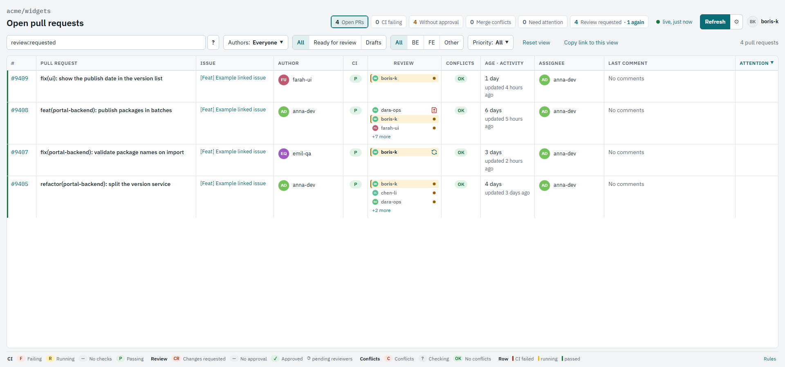 |

### 5. Search the way GitHub does

Type plain words, or GitHub-style qualifiers such as `label:bug`, `author:anna-dev`, `ci:failing`, `review:requested`,
or `-is:draft`. The **?** button lists them all with examples you can click. The whole view, search included, lives in
the link, so you can send someone exactly what you see.

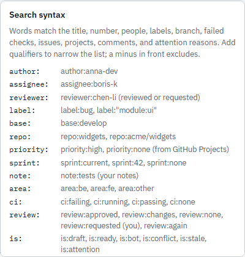

### 6. Read the whole conversation

Click the last comment to open every comment and review of the PR in a panel on the right, rendered as GitHub
Markdown, with tables, task lists, and code.

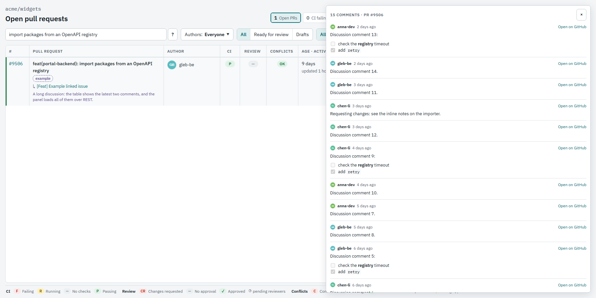

### 7. Keep notes for the standup

The ✎ after a title opens a Markdown note for that PR: what was asked at the standup and what was promised. Notes stay
in your browser, and `note:` searches them.

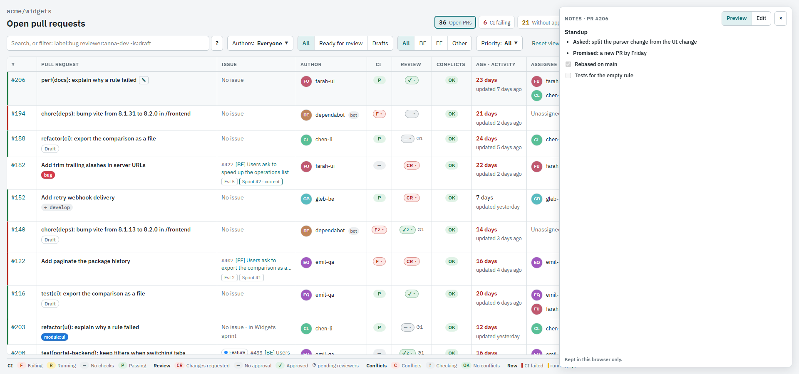

### 8. Several repositories, grouped

One board can follow up to 40 repositories. Put them in groups in Settings, such as Backend and Frontend, check the
groups you want in the Repositories menu, and each repository name takes its group's tint. Only the checked groups
load, and the link carries the groups to whoever opens it.

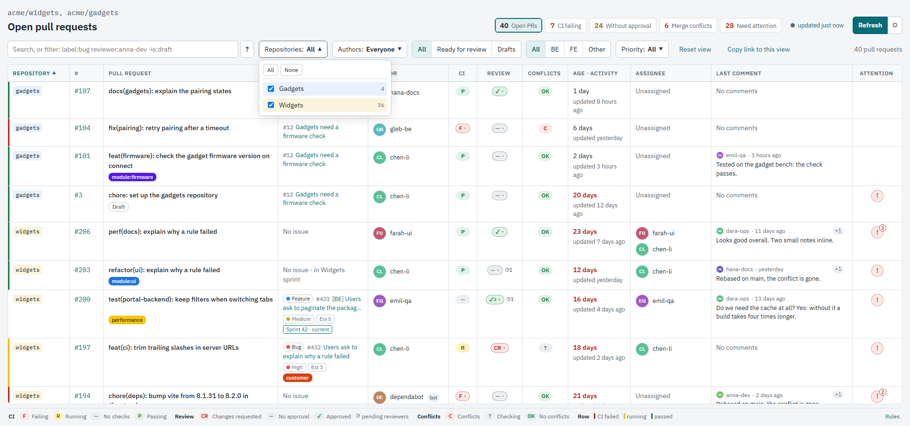

### 9. Make it yours

On the first visit the board shows at once, with a small card that offers a short tour. The tour shows every choice
as a picture: light, dark, or system theme, row density, the Review column, the reviewers order, and labels. Settings
has the rest: attention rules, BE and FE areas, columns and their order, and how often live data loads again.

| The first visit | The tour |
| --- | --- |
| 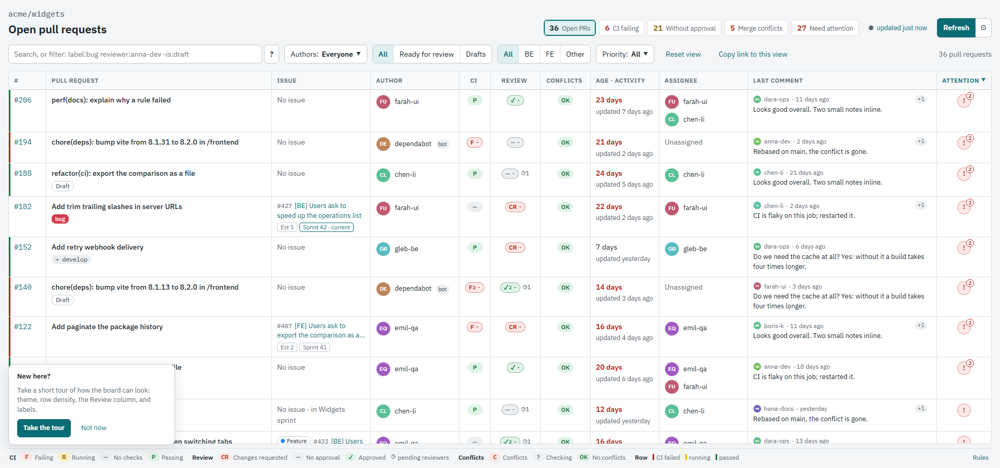 | 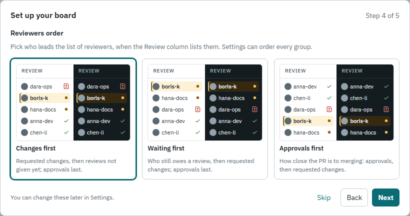 |
| **The dark theme** | **Settings** |
| 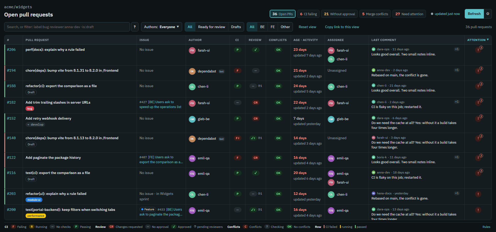 | 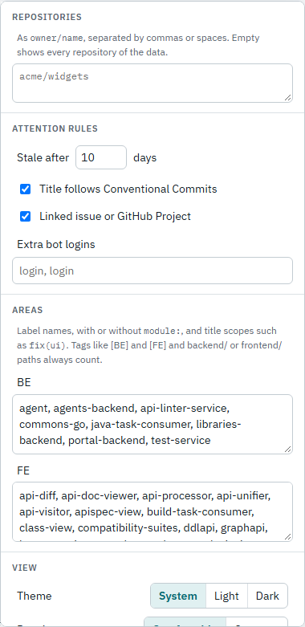 |

## How it works

- The workflow builds the page and publishes it on GitHub Pages. The page holds no data and the workflow uses no
  token.
- The page is React and TypeScript, bundled by Vite. It queries GitHub from the browser with the viewer's own
  fine-grained token, which stays in that browser and never goes into the link.
- With repositories in the link and a saved token, the board loads by itself when it opens. **Refresh** loads it
  again. Without a token, a dialog explains how to create one on GitHub and takes it.
- A live load shows what it reads, repository by repository, with a spinner and a clock, then how many pull requests
  it loaded and how long that took. Over a full table the status sits in a corner, so the rows stay in place.
- `src/github/` holds the query, the normalization, and the GitHub clients. `scripts/build-site.ts` can still write a
  `prs.json` snapshot next to the page, so it opens without a token; the workflow does not run it.

## Using the board

- **Search** takes plain words and GitHub-style qualifiers: `label:bug`, `label:"good first issue"`, `author:`,
  `assignee:`, `reviewer:` (reviewed or requested), `area:be|fe|other`, `ci:failing`, `review:approved`,
  `review:requested`, `is:draft|bot|conflict|stale|attention`, `no:issue|label|assignee|review`, `repo:`,
  `priority:`, `sprint:current`, `note:`. `label:`, `repo:`, and `priority:` match a whole name. A minus excludes:
  `-is:draft`.
  A linked issue number such as `885` finds its PR.
  The **?** button next to the field lists them. Click a label on a row to filter by it.
- **Area** (BE, FE, Other) comes from the labels and Conventional Commits scopes listed in Settings, `[BE]`/`[FE]`
  tags in the PR and issue titles, and `frontend` or `backend` directories in Dependabot titles.
- **Column widths** change by dragging the header edge, or with the arrow keys on a focused edge. They are saved
  in this browser; double-click an edge to reset that column. **Column order** changes with the arrows in Settings
  and travels in the link.
- **Setup wizard:** the first visit opens the board at once, with a small card that offers a short tour. The tour shows
  the theme, the row density, the Review column, the reviewers order, and labels as cards with a picture of the board in
  each look; every choice applies at once. **Setup wizard** in Settings opens it again.
- **Settings** (the gear next to Refresh): repositories and repository groups, attention rules, BE/FE lists, extra bots,
  theme, density, labels, the Review column as a code or as GitHub's list of reviewers, the order of the reviewer groups
  in that list, the columns and their order, how often live data loads again, and the GitHub token. The page address
  carries the repositories, extra bots, hidden columns, column order, and groups, so a copied link or a bookmark carries
  them; the rest is saved in this browser.
- **Repository groups:** define groups in Settings, one per line (`Backend: owner/a, owner/b`), with a leading `*`
  for a group checked when the board opens. The Repositories menu then shows the rows of the checked groups, and
  Ungrouped those of the repositories in no group. Without repositories in the link, only the checked groups load.
  Each group has its own tint on the repository names. The link carries the groups, without replacing the ones saved
  in a viewer's browser.
- **Several repositories:** with more than one, a Repository column comes first. A link such as
  `?repos=owner/a,owner/b` shows just those.
- **Notes:** the ✎ icon after a PR title opens a Markdown note for that PR, with Preview and Edit, such as what was
  asked at the standup and what was promised. It shows on hover, and always once the PR has a note. Notes stay in this
  browser; `note:` searches them.
- Click the last comment to open every comment of the PR in a panel on the right, rendered as GitHub Markdown.
  Without a token, GitHub allows 60 such loads an hour.
- The dot next to the tiles shows where the data comes from (gray for a `prs.json` snapshot, green for live data)
  and how old it is. Click it for the exact time and the workflow run.
- Click **F** in the CI column to see which checks failed, with links to their logs.
- Click the Review code to see who approved or requested changes and whose review is still pending.
  A small number on the code counts the reviewers behind that decision, for example ✓2 for two approvals.
  A gray ◷ counter next to it shows how many requested reviewers have not answered yet.
- **Your reviews:** with live data, click the Review requested tile to see every PR that waits for your review. As on
  GitHub, the Review column marks them with an orange dot, or with circular arrows when you are asked again after an
  earlier review. `review:requested` and `review:again` search them.
- The table always fills the window: spare width goes to the Pull request and Last comment columns.

## Local development

Requires Node.js 22.18 or later.

```sh
npm install
npm run dev          # http://localhost:5173 with mock data and hot reload
npm test
npm run typecheck
npm run test:e2e          # browser tests
npm run test:screenshots  # screenshots against the Windows baselines
```

The dev server injects a **DEV** panel in the bottom-right corner. Use it to switch scenarios:

- **prs.json on page load:** typical board plus corner cases, two repositories, empty board, 300 PRs, project data
  unavailable, stale snapshot, slow load, missing file, invalid JSON, JSON without a PR list.
- **Live loads:** success, pagination, partial GraphQL errors, project fields refused on a later page, fewer PRs than
  `totalCount`, slow response, pages one by one, 401, 502, repository not found, network failure. Any token works in
  mock mode.

All mock data is fictional. `dev/fixtures/typical.ts` generates an ordinary board with a fixed seed, and
`dev/fixtures/cases/` holds the corner cases, one file per topic. `dev/fixtures/gadgets.ts` is a second repository,
`acme/gadgets`, whose PR numbers repeat those of `acme/widgets`. All are raw GraphQL nodes, so they go through the
same normalization as real data.

To work against real data, run `npm run dev:live`. It behaves like the published page: open
`http://localhost:5173/?repos=owner/name`, save a token in Settings, and the board loads. With `GITHUB_TOKEN` and
`PR_BOARD_REPO` set, the dev server also serves those repositories as a `prs.json` snapshot.

## Deployment

1. In the repository settings, open **Pages** and set **Source** to **GitHub Actions**.
2. Push to `main`, or run the **Publish board** workflow manually. It runs the unit and browser tests first, and a
   failing test stops the deploy.
3. Share a link that names the repositories: `https://<owner>.github.io/<repo>/?repos=owner/name,owner/other`
   (up to 40). Each viewer saves their own fine-grained token, with public repository read access, in Settings.

A repository the token cannot read becomes a warning on the board. If project membership is not readable with the
token, the board says so and reports such PRs as unchecked instead of guessing.
